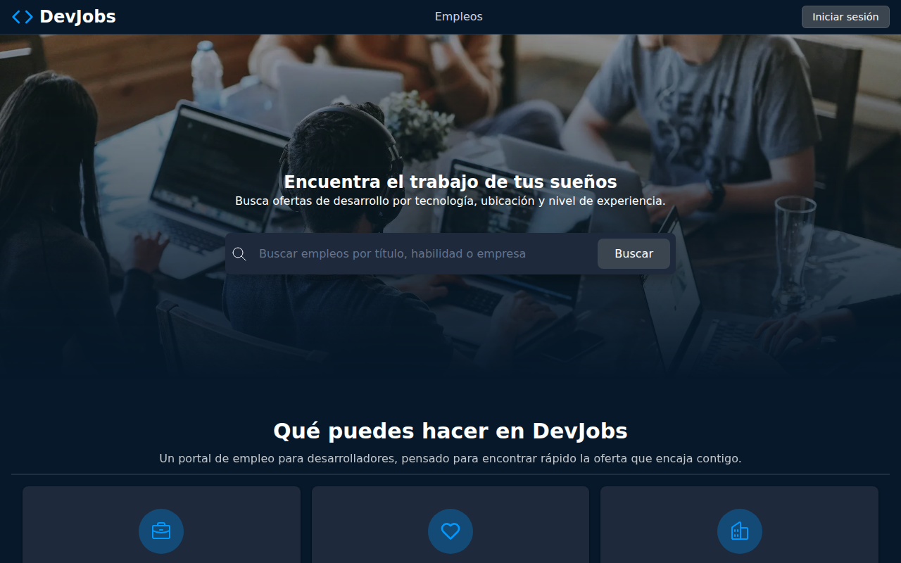
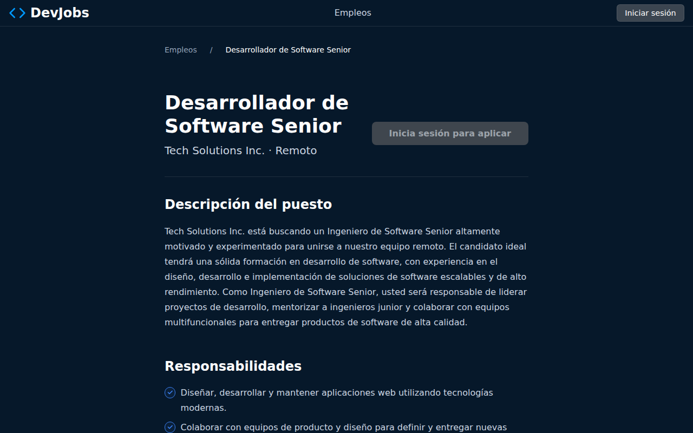
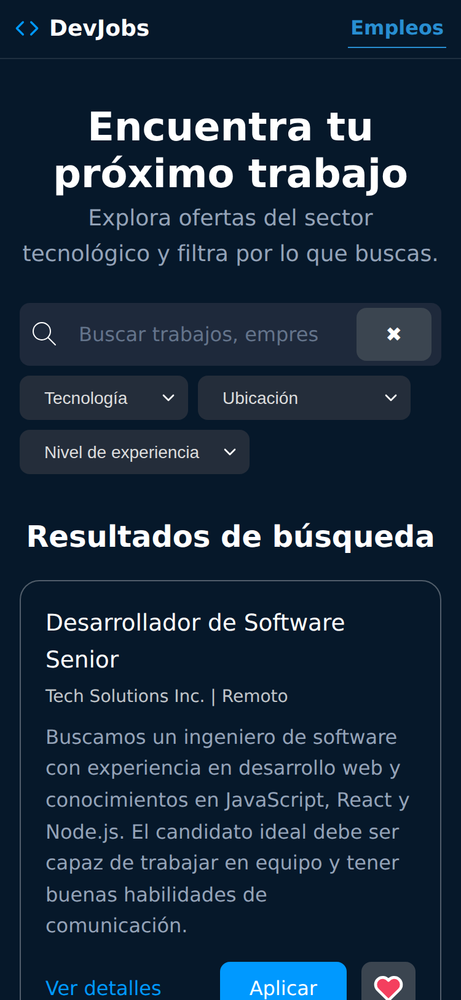

# DevJobs

[](https://github.com/CheT018/devjobs/actions/workflows/ci.yml)

Portal de empleo para desarrolladores. Permite buscar ofertas por texto, filtrarlas por tecnología, ubicación y nivel de experiencia, y consultar el detalle de cada una.

Es una aplicación full stack en un monorepo: una web en React y una API REST propia con base de datos SQLite.

**Demo:** [devjobs-lilac.vercel.app](https://devjobs-lilac.vercel.app)



<p>
  
  
</p>

## Origen del proyecto

DevJobs empezó como proyecto del bootcamp de midudev en [JsCamp](https://www.jscamp.dev/). La web, la API, la base de datos, los tests, Docker y la integración continua se hicieron siguiendo el curso. Después fui añadiendo:

- API de solo lectura en producción, para proteger la demo pública ([#7](https://github.com/CheT018/devjobs/pull/7)).
- Sesión, favoritos y candidaturas que se conservan al recargar ([#8](https://github.com/CheT018/devjobs/pull/8)).
- Diseño adaptado al móvil, con los tests de extremo a extremo también en móvil ([#9](https://github.com/CheT018/devjobs/pull/9)).
- Textos de la portada ajustados a lo que hace la aplicación ([#10](https://github.com/CheT018/devjobs/pull/10)).
- Despliegue en Vercel, con la web y la API en el mismo dominio ([#11](https://github.com/CheT018/devjobs/pull/11)).
- Imágenes base de Docker fijadas por versión y digest.

## Stack

| Parte | Tecnologías |
| --- | --- |
| Web | React 19, TypeScript, Vite, React Router, Zustand, CSS Modules |
| API | Node.js, Express 5, TypeScript, SQLite (better-sqlite3), Zod |
| Tests | `node:test` para la API, Playwright para los tests de extremo a extremo |
| Herramientas | pnpm workspaces, Oxlint, GitHub Actions, Docker, Vercel |

## Estructura

```
api/              Punto de entrada de la API como función de Vercel
apps/
  api/            API REST (rutas → controladores → modelos)
  web/            Aplicación React
packages/
  shared/         Tipos del contrato entre la API y la web
e2e/              Tests de extremo a extremo
```

## Puesta en marcha

Requisitos: Node.js 24 y pnpm 12.

```bash
pnpm install
pnpm dev
```

- Web: http://localhost:5173
- API: http://localhost:3000/api

La primera vez que arranca, la API crea la base de datos en `apps/api/data/jobs.db` y carga 34 ofertas de ejemplo. En desarrollo, Vite redirige las peticiones a `/api` hacia la API local.

### Con Docker

```bash
docker compose up --build
```

La aplicación queda en http://localhost:8080 y la API en http://localhost:8080/api. Los datos se guardan en un volumen, así que sobreviven a los reinicios.

## Despliegue

La [demo](https://devjobs-lilac.vercel.app) está en Vercel, en un único proyecto. La web se sirve como estática y la API como una función (`api/index.js`) en el mismo dominio, así que no hace falta configurar CORS. La configuración está en `vercel.json`.

La API se despliega en modo solo lectura: cada instancia crea la base de datos en memoria y carga las ofertas de ejemplo al arrancar. Solo `ALLOW_WRITES=true` activa las escrituras.

Para desplegarlo en otro proyecto de Vercel hay que añadir la variable `ENABLE_EXPERIMENTAL_COREPACK=1`, para que use la versión de pnpm de `package.json`. Con Docker se puede desplegar en cualquier servicio de contenedores; ver [Con Docker](#con-docker).

## Scripts

Se ejecutan desde la raíz del repositorio.

| Comando | Qué hace |
| --- | --- |
| `pnpm dev` | Arranca la API y la web en modo desarrollo |
| `pnpm build` | Compila la API y la web |
| `pnpm lint` | Analiza el código con Oxlint |
| `pnpm typecheck` | Comprueba los tipos de todos los paquetes |
| `pnpm test` | Ejecuta los tests de la API |
| `pnpm test:e2e` | Ejecuta los tests de extremo a extremo |
| `pnpm seed` | Borra las ofertas y vuelve a cargar los datos de ejemplo |

Los tests de extremo a extremo levantan su propia API, con una base de datos en memoria, y su propia web. Se ejecutan dos veces: en escritorio y en un móvil de 360 px de ancho. La primera vez hay que instalar el navegador:

```bash
pnpm --filter @devjobs/e2e exec playwright install chromium
```

## API

| Método | Ruta | Descripción |
| --- | --- | --- |
| `GET` | `/api/jobs` | Lista de ofertas, con filtros y paginación |
| `GET` | `/api/jobs/:id` | Detalle de una oferta |
| `POST` | `/api/jobs` | Crea una oferta |
| `PATCH` | `/api/jobs/:id` | Actualiza parcialmente una oferta |
| `DELETE` | `/api/jobs/:id` | Elimina una oferta |
| `GET` | `/api/health` | Comprobación de estado |

En producción (`NODE_ENV=production`, como en la imagen de Docker) la API funciona en modo solo lectura: `POST`, `PATCH` y `DELETE` responden `403`. Se controla con la variable `ALLOW_WRITES`.

### Parámetros de `GET /api/jobs`

| Parámetro | Descripción |
| --- | --- |
| `text` | Busca en el título, la empresa, la descripción y las tecnologías |
| `technology` | Tecnología exacta, por ejemplo `react` |
| `location` | Ubicación exacta, por ejemplo `Madrid` o `Remoto` |
| `modality` | `remote`, `onsite` o `hybrid` |
| `level` | `junior`, `mid` o `senior` |
| `limit` | Resultados por página, de 1 a 50 (por defecto 10) |
| `offset` | Resultados que se saltan (por defecto 0) |

```bash
curl "http://localhost:3000/api/jobs?technology=react&level=senior&limit=5"
```

```json
{
  "data": [
    {
      "id": "7a4d1d8b-1e45-4d8c-9f1a-8c2f9a9121a4",
      "title": "Desarrollador de Software Senior",
      "company": "Tech Solutions Inc.",
      "location": "Remoto",
      "description": "Buscamos un ingeniero de software con experiencia en desarrollo web...",
      "data": {
        "technology": ["react", "node", "javascript"],
        "modality": "remote",
        "level": "senior"
      }
    }
  ],
  "total": 1,
  "limit": 5,
  "offset": 0
}
```

`total` es el número de ofertas que cumplen los filtros, no el tamaño de la página. El detalle de una oferta añade el campo `content`, con la descripción, las responsabilidades, los requisitos y la información de la empresa en Markdown.

Los datos de entrada se validan con Zod. Si no son válidos, la API responde `400` indicando cada campo:

```json
{
  "message": "Validation error",
  "errors": [{ "field": "title", "message": "title must be at least 3 characters" }]
}
```

## Variables de entorno

Todas son opcionales. Hay un ejemplo en `apps/api/.env.example` y otro en `apps/web/.env.example`.

| Variable | Dónde | Por defecto | Descripción |
| --- | --- | --- | --- |
| `PORT` | API | `3000` | Puerto de la API |
| `DB_PATH` | API | `data/jobs.db` | Archivo SQLite, o `:memory:` para una base de datos temporal |
| `CORS_ORIGINS` | API | `http://localhost:5173` | Orígenes permitidos, separados por comas |
| `ALLOW_WRITES` | API | `true`, o `false` con `NODE_ENV=production` | Permite `POST`, `PATCH` y `DELETE`; solo `true` las activa |
| `VITE_API_URL` | Web | `/api` | URL base de la API |

## Estado actual

- El inicio de sesión es simulado: un botón alterna el estado, sin usuarios ni contraseñas.
- Las rutas de escritura de la API no requieren autenticación; por eso están desactivadas en producción.
- La sesión, las candidaturas y los favoritos se guardan en el `localStorage` del navegador, no en la API.
